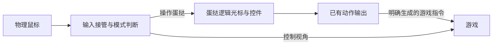

# 鼠标输入隔离：分支讨论与验证思路

- 记录日期：2026-10-07。
- 工作分支：`feature/mouse-input-isolation`。
- 创建基线：`main` / `48be954`（v0.5.2）。
- 状态：需求讨论与技术调研，尚未实现，也未完成《黑神话：悟空》的实机输入隔离验证。
- 本轮范围：记录讨论、建立分支并同步 Codeup；后续实现路线尚未选定。

## 1. 要解决的问题

用户希望在现代商业游戏中，用鼠标操作蛋挞悬浮层时，游戏不会因为同一次鼠标移动而转动视角；只有用户明确将鼠标控制权交回游戏后，鼠标才恢复控制视角。

首个验证对象是用户指定的《黑神话：悟空》。它虽然是第三人称游戏，但同样存在鼠标移动控制镜头的问题。第一人称游戏也是目标场景，不能以单款游戏验证通过推断所有商业游戏兼容。

本轮分析采用的工作假设是：操作蛋挞时，游戏仍保持前台和运行状态，蛋挞按钮仍能发送移动、技能等指令，只隔离用于选择和操作界面的物理鼠标输入。这是根据蛋挞用途提出的方案假设，用户尚未逐项确认操作期间需要保留哪些游戏动作。

目标行为如下，模式名称仅用于讨论：

| 模式 | 物理鼠标移动 | 用于操作蛋挞的实体点击 | 蛋挞生成的游戏指令 |
|---|---|---|---|
| 操作蛋挞 | 驱动蛋挞光标，不因这次移动带动游戏视角 | 交给蛋挞，不额外触发游戏原生点击动作 | 按方案发送移动、技能等指令 |
| 控制视角 | 交给游戏控制视角 | 按游戏操作处理，避免同时误触蛋挞按钮 | 已有持续动作如何保留或释放，需明确规则 |

这里的目标是消除物理鼠标操作与镜头之间的不必要联动。游戏自身的锁定跟随、自动镜头、受击表现和剧情镜头仍可能转动相机，不以“画面绝对静止”作为验收条件。

## 2. 当前架构已经具备什么

| 模块 | 当前职责 | 与本需求的关系 |
|---|---|---|
| [core/cursor_input.py](../core/cursor_input.py) | 用 `RIDEV_INPUTSINK` 旁听 Raw Input；检测游戏锁定系统光标后，累计位移形成独立坐标 | 已有独立光标的数据基础，但没有阻止游戏接收输入 |
| [views/pointer_overlay.py](../views/pointer_overlay.py) | 用不接收输入、不抢焦点的顶层窗口绘制光标 | 可以复用绘制能力；光标窗口本身不承担输入隔离 |
| [engine/ui_pointer.py](../engine/ui_pointer.py) | 按逻辑坐标向 Qt 控件分发事件；当前鼠标按钮状态来自 `GetAsyncKeyState` | 可以复用界面分发；拦截输入后需重新确认按钮状态来源 |
| [engine/passthrough_manager.py](../engine/passthrough_manager.py) | 设置窗口穿透样式，处理空白点击转发和游戏焦点 | 控制窗口交互，不等于阻止游戏读取原始鼠标位移 |
| [core/input_engine.py](../core/input_engine.py) | 发送键鼠指令；已有低级鼠标钩子用于监听滚轮 | 当前钩子继续调用下一钩子，没有实现鼠标移动隔离 |
| [engine/run_controller.py](../engine/run_controller.py)、[engine/gamepad_engine.py](../engine/gamepad_engine.py) | 将方案操作转换为键鼠、虚拟手柄等输出 | 可以继续作为明确的游戏指令输出端 |

已有[独立光标说明](cursor-preview.md)明确指出：只旁听鼠标，不注入游戏、不拦截游戏读取鼠标，游戏相机仍可能响应同一次物理移动。

因此，现有独立光标解决的是“系统光标被锁在中心时，蛋挞还能否操作”，本分支要研究的是“操作蛋挞的输入能否被游戏忽略”。两项能力需要配合。

现有检测器会自动判断是否启用独立坐标。新增的输入归属模式需要与它协调：检测到系统光标恢复移动，不应自行解释为用户要求将鼠标交回游戏。

## 3. 为什么关闭穿透不够

游戏转动镜头，不一定是蛋挞把鼠标移动转发给了游戏。游戏自己也可以读取物理鼠标。

Windows 的 Raw Input 与普通窗口鼠标消息是不同的输入路径。注册后的应用可以读取设备数据，使用相应标志时还可以在后台接收。蛋挞接住自己的窗口消息，不代表游戏的原始输入也被取消。

以下做法不能直接作为完整解决方案：

- **关闭悬浮窗穿透**：只能据此判断窗口交互发生变化，不能认定游戏的 Raw Input 或其他输入路径已被隔离。
- **固定系统光标、反复回中或解除光标限制**：屏幕上的光标坐标与设备相对位移不同；控制前者不能保证游戏看不到后者。
- **仅修改 Raw Input 注册标志**：`RIDEV_INPUTSINK` 是后台接收；`RIDEV_NOLEGACY` 影响注册应用的传统消息，不能把它当作全局独占鼠标开关。
- **让游戏失去焦点**：可能停止视角响应，也可能影响游戏运行、输入接收和蛋挞的按键输出；后台接收输入的游戏仍可能继续响应。它不能作为上述工作假设下的默认方案。
- **仅改成虚拟手柄输出**：可以改变蛋挞发送指令的方式，但不能据此阻断实体鼠标对游戏的影响。

Windows 低级鼠标钩子可以阻止消息继续进入钩子链或目标窗口过程，但这项接口说明不足以证明所有游戏的鼠标输入路径都会被阻断。是否足够用于《悟空》，需要实测。

## 4. 可选技术路线

| 路线 | 思路 | 适用判断与限制 |
|---|---|---|
| 普通 Windows 鼠标钩子 | 在蛋挞模式中拦截相关实体鼠标事件，向蛋挞提供事件，按规则放行游戏指令 | 改动范围相对可控，可作为首轮验证候选；不能预先承诺覆盖 Raw Input、缓冲读取或其他游戏输入路径 |
| 游戏内输入适配 | 在游戏实际消费鼠标输入的位置控制位移或按钮，保留需要的其他输入 | 更接近游戏覆盖层的接入方式；需要游戏支持、允许的插件接口或进程内适配，兼容性与维护取决于具体游戏和版本 |
| 驱动层分流 | 在所接管设备的输入进入常规系统分发前，决定交给蛋挞还是继续交给游戏 | 有机会覆盖更多常规用户态输入路径；需要设备事件通道、驱动签名与安装维护，并评估商业游戏的反作弊兼容性，不能承诺通用支持 |

Steam 官方文档说明其覆盖层会接入游戏进程。ReShade 的输入代码同时处理窗口消息、鼠标状态及原始输入缓冲，并另有 DirectInput 处理。这些资料说明，更深入的输入接入是一条实际存在的路线；它们不证明安装这些工具后，蛋挞就能直接获得同样的能力，也不构成《悟空》兼容性验证。

建议先以《悟空》评估普通鼠标拦截能否同时满足“视角隔离、蛋挞仍可操作、游戏指令仍有效”。如果游戏仍收到位移，就根据证据讨论游戏内适配或驱动分流，不继续把窗口样式变化当作完整输入隔离。

## 5. 对蛋挞架构的建议

保留 PyQt6 界面、场景控件、独立光标绘制和已有动作输出，增加受明确模式控制的输入接管能力。以下是能力关系示意，不代表已选定接口或实现：

接管层需要同时解决两个问题：阻止游戏消费不应收到的输入，以及让蛋挞仍能读取被接管的输入。

尤其是驱动层分流：如果输入在 Raw Input 生成之前就被截住，现有 Raw Input 监听也可能收不到这些事件，必须提供到蛋挞的专用事件通道。鼠标按钮也不能继续无条件依赖 `GetAsyncKeyState`；需要统一记录位移、按下、松开、滚轮和侧键状态，避免出现“游戏停住了，蛋挞也操作不了”。

实体输入与蛋挞明确生成的指令需要区分。已有 `INJECT_MAGIC` 可供适用的 Win32 路径参考，但不能假设所有后端都保留该标记，也不能把所有合成输入一律视为可放行。

### 模式切换应满足的行为

1. 用户在移向按钮之前就能进入蛋挞模式。只在悬停按钮时开始隔离，会让前往按钮途中仍然转动视角。
2. 将鼠标交回游戏必须有明确操作，例如可配置侧键或模式切换入口；按住切换还是点击切换，本轮尚未决定。
3. 蛋挞模式中的实体点击不能额外触发游戏攻击等动作，蛋挞按钮生成的目标指令仍需正常执行。
4. 切换时不回放被隔离的位移或点击；需要处理坐标衔接，避免交回游戏时突然甩镜头。
5. 按下与松开必须成对管理。进入另一模式时仍按住的按钮，不应成为新模式中的一次意外点击；已有持续动作的释放规则需要明确。
6. 接管只在目标游戏的有效会话中生效。切换到其他应用、退出运行或后端失效时，应释放接管及本会话持有的输入状态，恢复正常桌面操作。

## 6. 《黑神话：悟空》的验证顺序

下列步骤是后续工作计划，本次没有执行，也没有通过记录。

### 第一步：记录基线

记录游戏版本、Windows 版本、显示模式、鼠标型号及回报率、蛋挞布局和启用功能。先在同一可重复场景确认：没有隔离时，物理鼠标如何驱动镜头、独立光标和按钮。

优先用未锁定目标、没有剧情或自动跟随干扰的场景判断鼠标引起的转动，随后再覆盖锁定目标与战斗状态。

### 第二步：验证最小输入隔离能力

保持游戏前台，观察以下三件事能否同时成立：

1. 移动鼠标时，蛋挞逻辑光标正常移动，游戏不因这次移动转视角。
2. 点击或悬停蛋挞控件时，配置的游戏动作仍能执行，实体点击不产生额外动作。
3. 用户交回鼠标后，视角立即恢复响应，并且没有积累位移造成的跳变。

仅“系统光标不动”、仅“按钮不穿透”或“游戏因为失焦不再响应”均不算验证通过。

### 第三步：检查模式与场景边界

| 场景 | 验收重点 |
|---|---|
| 自由探索与战斗 | 操作蛋挞不联动鼠标视角，移动和技能输出有效 |
| 锁定目标 | 区分游戏自动跟随与物理鼠标输入，不把锁定机制误判为隔离成功 |
| 蛋挞按钮、圆盘、摇杆 | 逻辑坐标与命中一致，无额外实体点击；持续动作可正常结束 |
| 鼠标按住时切换模式 | 不误触、不重复触发、不遗留按住状态 |
| 快速往返切换 | 不补发旧事件，不甩镜头，切换入口始终可用 |
| 游戏菜单与蛋挞工具栏、弹窗 | 明确输入归属，光标和交互均可恢复 |
| Alt+Tab、退出运行、后端中断 | 恢复桌面输入，释放本会话的接管和持续动作 |
| 窗口、无边框及游戏支持的全屏模式 | 分别记录覆盖层可见性与输入隔离结果，避免混为同一问题 |

普通钩子失败时，应记录究竟是游戏仍收到位移、蛋挞丢失事件、焦点变化，还是坐标与按钮状态不一致。采用哪条后续路线取决于这些证据。

## 7. 仍待决定的事项

- 按住切换、点击切换或其他入口，以及进入游戏后的默认模式。
- 操作蛋挞期间需要保留的游戏指令，特别是持续移动与鼠标攻击映射。
- 首轮只适配《悟空》，还是同步选择一款第一人称游戏作为对照。
- 普通钩子不足时，对专用游戏适配、驱动安装和后续维护成本的取舍。
- 游戏菜单、蛋挞编辑界面和失焦状态如何衔接现有独立光标自动检测。

当前没有选定驱动或游戏内适配方案，没有新增快捷键，也没有建立“所有现代商业游戏均可隔离”的承诺。后续验证应把实际结果补入本文，再据此确定实现范围。

## 8. 调研依据

以下资料在本轮讨论中用于核对输入机制与实现路线；外部项目代码可能继续变化。

- [Microsoft：Raw Input 概述](https://learn.microsoft.com/en-us/windows/win32/inputdev/about-raw-input)——设备输入、窗口消息与后台接收的区别。
- [Microsoft：RAWINPUTDEVICE](https://learn.microsoft.com/en-us/windows/win32/api/winuser/ns-winuser-rawinputdevice)——`RIDEV_INPUTSINK`、`RIDEV_NOLEGACY` 等标志的含义。
- [Microsoft：LowLevelMouseProc](https://learn.microsoft.com/en-us/windows/win32/winmsg/lowlevelmouseproc)——低级鼠标钩子的阻止范围、消息循环及超时行为。
- [Microsoft：SendInput](https://learn.microsoft.com/en-us/windows/win32/api/winuser/nf-winuser-sendinput)——合成输入及其适用限制。
- [Steamworks：Steam Overlay](https://partner.steamgames.com/doc/features/overlay)——覆盖层接入游戏的方式。
- [ReShade：Windows 输入处理](https://github.com/crosire/reshade/blob/main/source/input_windows.cpp)与 [DirectInput 处理](https://github.com/crosire/reshade/blob/main/source/windows/dinput8.cpp)——多种输入路径需要分别处理的实际例子。
- [Microsoft：键盘与鼠标 HID 客户端驱动](https://learn.microsoft.com/en-us/windows-hardware/drivers/hid/keyboard-and-mouse-hid-client-drivers)——驱动栈及过滤驱动能力。
